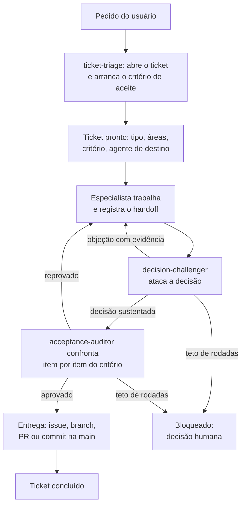

<!-- managed-by:cceak/sync-ai-surfaces — do not edit by hand -->
<!-- source: skills/ticket-loop/SKILL.md -->

Todo pedido feito neste projeto vira um ticket, e nenhum ticket avança sem que o
agente anterior tenha dito por escrito o que fez, o que decidiu e o que o próximo
precisa saber. O critério de aceite é escrito no começo, com o usuário, e conferido
no fim por quem não participou da obra. O loop tem tetos: ele termina por aceite ou
por bloqueio, nunca por cansaço.

Irmãos: `.claude/agents/ticket-triage.md` (entrada) ·
`.claude/agents/decision-challenger.md` (contraditório) ·
`.claude/agents/acceptance-auditor.md` (saída) · `scripts/tickets/ticket.py` (CLI) ·
`tickets/INDEX.md` (quadro) · `docs/projeto/sdd/sistema-de-tickets.md` (contrato).

## Quando usar

No primeiro pedido de qualquer atividade — inclusive pedido pequeno, inclusive
pergunta que vira trabalho. Não use para pergunta que se responde com uma frase e
não deixa artefato.

## O loop



## Passos

1. **Abrir.** O `ticket-triage` cria o ticket antes de qualquer trabalho:

   ```bash
   python3 scripts/tickets/ticket.py new --type <feature|bug|docs|chore|spike|external-setup|research> \
     --title "<título>" --areas <área>,<área> --priority <p0..p3>
   ```

2. **Critério de aceite.** A triagem entrevista o usuário até cada item virar algo
   verificável por terceiro. Sem isso o ticket não sai de `especificacao` — o
   `ticket.py validate` reprova.

3. **Rotear.** Um agente por etapa, escolhido pela área. O handoff é obrigatório e
   carrega contexto de verdade:

   ```bash
   python3 scripts/tickets/ticket.py handoff <ID> --from <agente> --to <agente> \
     --note "o que já se sabe, os arquivos que importam, o que NÃO fazer"
   ```

   O CLI recusa handoff sem `--note` e recusa handoff de um agente para ele mesmo.

4. **Trabalhar.** O especialista move o ticket para `em-andamento`, faz o trabalho e
   escreve no `## Histórico` o que decidiu e com que evidência. Depois move para
   `revisao`.

5. **Contraditório.** O `decision-challenger` ataca a decisão. `objecao` devolve o
   ticket a `contestado` e a correção gasta uma rodada; `ok` libera para o aceite.

6. **Aceite.** O `acceptance-auditor` confere item por item com evidência que ele
   mesmo executou, e aprova ou reprova. Um item não atendido reprova o ticket inteiro.

7. **Entrega.** `python3 scripts/tickets/ticket.py git-plan <ID>` imprime o fluxo do
   tipo. `bug` e `feature`: issue no GitHub, branch `fix/`/`feat/`, PR que fecha a
   issue com `Closes #N`, CI verde antes do merge, merge na `main` e branch removida
   (`gh pr merge <PR> --merge --delete-branch`). **Uma issue, um PR, um ticket** — PR
   que carrega ticket de outro deixa issue aberta para sempre. `docs`, `chore`,
   `external-setup`, `research`: commit direto na `main`. A mensagem do commit
   sempre termina com o id: `feat(dados): ... (TCK-0007)`.

8. **Registrar o elo.** Depois do merge, `set <ID> --pr <N>` e as três linhas de
   `## Entrega` preenchidas: `- Issue:` com o número, o link do GitHub e o veredito
   **estruturado** — `fechada:#<PR>`, ou `aberta:TCK-NNNN` nomeando o ticket sucessor
   quando a verificação reprovou; `- Branch:` com o nome da branch; `- PR:` com o
   número e o link. Palavra em prosa não vale: "será fechada depois" é reprovado. O
   `validate` cobra isso a partir de `aceite` e, quando há credencial, confere no
   GitHub se o veredito bate com o estado real da issue — sem `gh`, avisa e sai 0.

9. **Fechar.** `move <ID> concluido` só passa com `acceptance: aprovado`.

## Guardrails contra loop infinito

O que impede o loop de girar para sempre está no CLI, não na boa vontade dos agentes:

| Guardrail | Onde vive | O que faz |
|---|---|---|
| Teto de rodadas (`max_rounds`, padrão 3) | `ticket.py move` | A 3ª volta de `contestado` para `em-andamento` bloqueia o ticket e chama o humano. |
| Teto de objeções (`max_challenges`, padrão 2) | `ticket.py challenge` | A 3ª objeção é recusada; a disputa vai ao humano. |
| Transição válida | `ticket.py move` | Só as transições do fluxo passam; salto é recusado com código 2. |
| Sem autoentrega | `ticket.py handoff` | Nenhum agente passa o ticket para si mesmo. |
| Handoff com contexto | `ticket.py handoff` | Handoff sem `--note` é recusado — o próximo nunca começa às cegas. |
| Aceite antes de concluir | `ticket.py move` | `concluido` exige `acceptance: aprovado`. |
| Ponto vencido fica vencido | `decision-challenger` | Objeção já sustentada com evidência não volta. |
| Gate no commit | `pre-commit` | Ticket inválido, índice desatualizado ou branch sem ticket barram o commit. |
| Elo issue ↔ PR ↔ ticket | `ticket.py validate` | Ticket de tipo com PR em `aceite`/`concluido` sem `pr:`, sem `## Entrega` com link ou sem veredito estruturado é reprovado — foi assim que quatro issues ficaram abertas com o ticket fechado (TCK-0021). |
| Registro que mente | `ticket.py validate` (com credencial) | Veredito `fechada` com a issue aberta no GitHub, ou `aberta` com ela fechada, reprova. Sem rede: aviso por ticket e nenhum vermelho. |

Ao bater um teto, a saída é sempre a mesma: parar, escrever no ticket as duas opções
em disputa e o custo de cada uma, e devolver a decisão ao humano. Nunca reabrir.

## Verificação

```bash
python3 scripts/tickets/ticket.py board
python3 scripts/tickets/ticket.py validate
python3 scripts/tickets/ticket.py validate --offline  # só o registro local, sem rede
```

Esperado: o quadro mostra cada ticket na coluna certa, nenhum ticket com `⟲` igual ao
teto fora de `bloqueado`, e o `validate` termina com `tickets ok`. Sem `gh` instalado
ele sai 0 do mesmo jeito — imprime um `aviso:` por ticket e confere só o registro
local.
